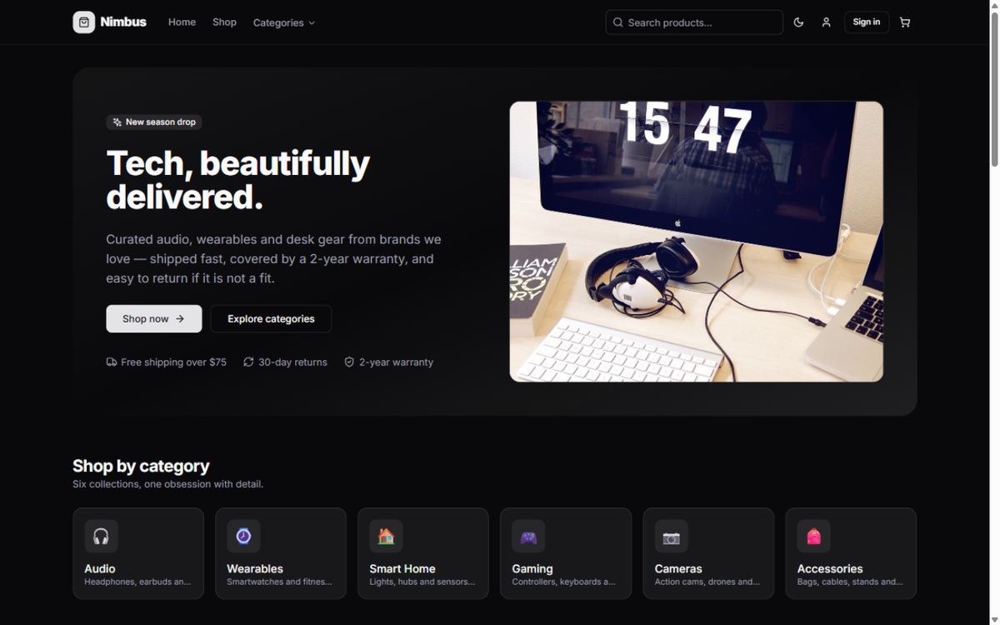
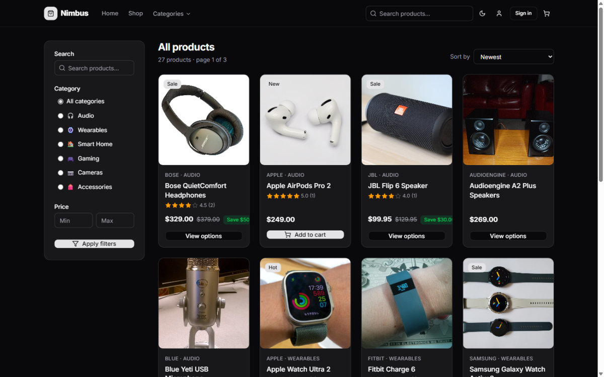
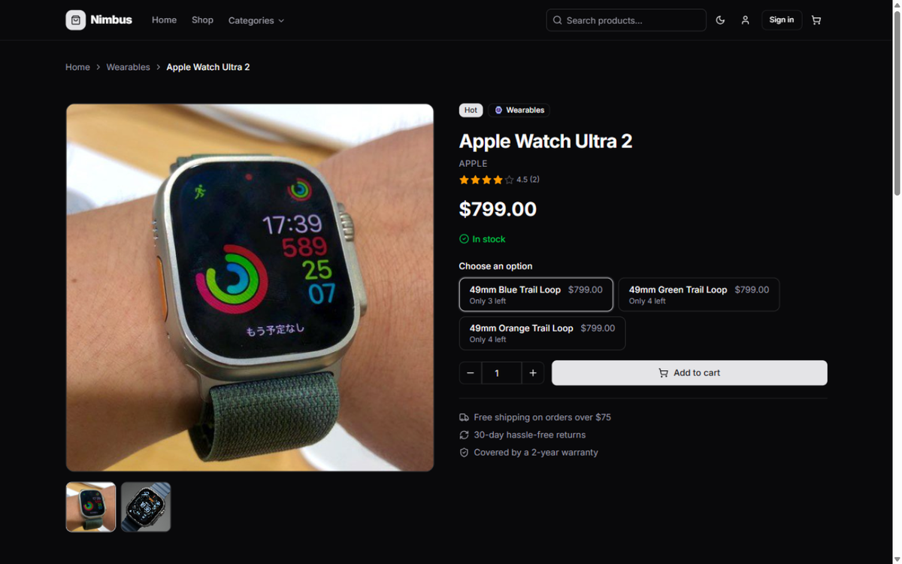
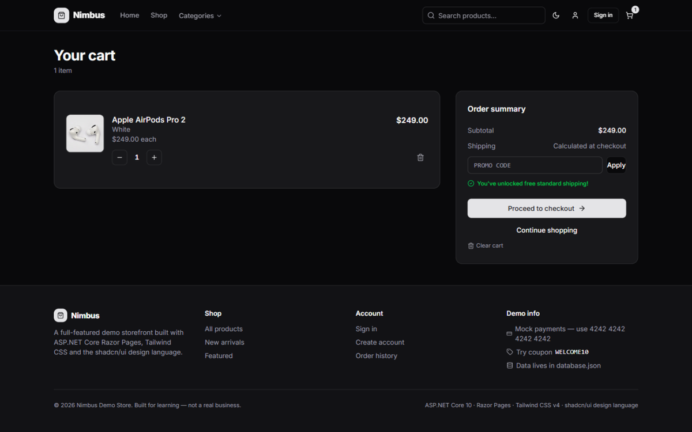
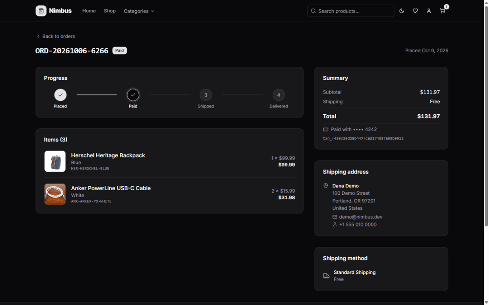
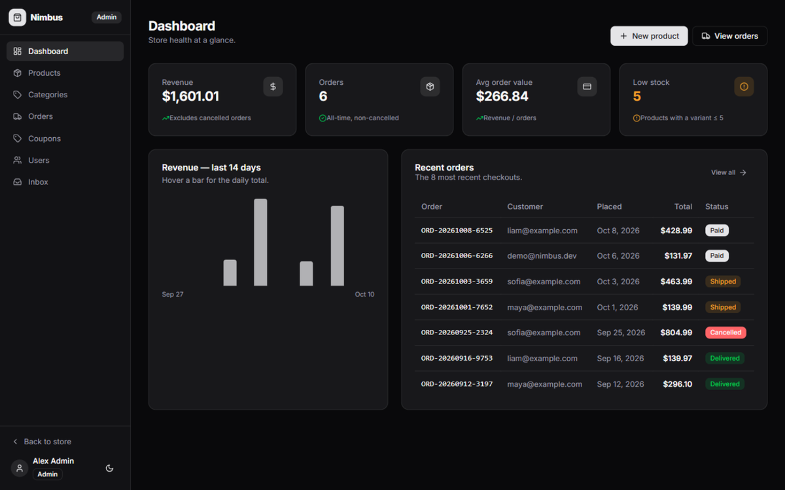
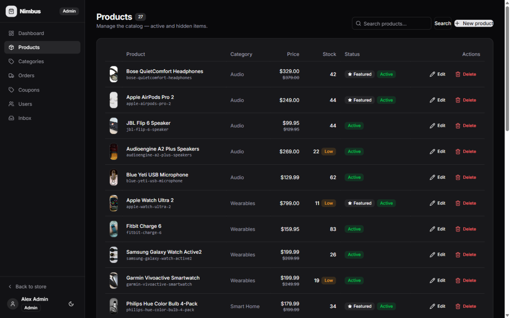

# Nimbus — a full-featured e-commerce demo

A complete storefront + admin experience built with **ASP.NET Core 10 Razor Pages**, **Tailwind CSS v4** and the **shadcn/ui design language**, persisted to a single **database.json** file. Built as a portfolio / learning project: every boundary (persistence, payments, email) sits behind an interface so each piece can be swapped for the "real" thing later.

## Screenshots

| | |
|---|---|
|  |  |
| **Home** | **Catalog** |
|  |  |
| **Product detail** | **Cart** |
|  |  |
| **Order tracking** | **Admin dashboard** |
|  | |
| **Admin · Products** | |

## Quick start

```bash
# 1. CSS (first time + whenever you touch app.src.css or pages)
npm install
npm run css:build        # or: npm run css:watch  while developing

# 2. Run
dotnet run --project src/ECommerce.Web
```

Open the URL it prints (default `http://localhost:5000`). On first run the app creates `database.json` at the repo root. Delete `database.json` any time to reset the demo data.

### Demo accounts

| Role     | Email             | Password    |
| -------- | ----------------- | ----------- |
| Admin    | admin@nimbus.dev  | `Admin123!` |
| Customer | demo@nimbus.dev   | `Demo1234!` |

### Mock payment cards

| Card number           | Result               |
| --------------------- | -------------------- |
| `4242 4242 4242 4242` | Approved (any valid card works) |
| any number ending `0002` | Declined          |
| any number ending `9995` | Insufficient funds |
| any number ending `0069` | Expired card      |

Use any future expiry (`12/34`) and any 3-digit CVC. Coupons to try: `WELCOME10`, `SAVE20` (min $100), `NIMBUS5` (min $30).

## What's inside

**Storefront:** home with featured products and categories, catalog with search / category / price filters / sorting / pagination, product pages with variant pickers, ratings and reviews, persistent cart (anonymous cookie → merged into your account at login), coupons, checkout with shipping options, mock payment, order confirmation and order history with status timeline, wishlist.

**Admin (`/Admin`, role-gated):** dashboard with revenue chart and stats, product CRUD with variant editor and image upload, category management, order management with status advancement (restocks on cancel), coupon management, user role management, and a mock email **Inbox** showing every transactional email the system "sent".

## Architecture

```
src/
├─ ECommerce.Web/        Razor Pages UI (storefront + Admin area), Tailwind theme
├─ ECommerce.Core/       Entities, service interfaces, business logic
└─ ECommerce.Data.Json/  IRepository<T> over database.json + demo seeder
```

- **Persistence seam** — everything goes through `IRepository<T>` and the service interfaces in `ECommerce.Core.Interfaces`. Today a `JsonDataStore` (in-memory graph, atomic single-writer file writes) backs it. To move to EF Core + SQL Server later, add an `ECommerce.Data.EntityFramework` project implementing the same repositories and change the DI registrations in `Program.cs` — no page or service code changes.
- **Payments** — `IPaymentService` / `MockPaymentService` with Luhn validation and Stripe-style test-card semantics; swap for a Stripe implementation later.
- **Email** — `IEmailService` records messages the admin Inbox displays; swap for SMTP/SendGrid later.
- **Auth** — cookie authentication with `PasswordHasher<T>` hashing; roles are claims; the admin area is protected by an authorization policy.
- **Money** — `decimal` everywhere, formatted via the `Money()` extension (USD).

## Design system

Tailwind v4 with shadcn/ui's token system (`src/ECommerce.Web/wwwroot/css/app.src.css`): the oklch color palette, radius scale, dark mode (class strategy, persisted in localStorage), and shadcn's component look (`btn`, `card`, `input`, `badge`, `alert`, `table-shad`, `menu`…) as plain utility classes, plus a `<icon name="…"/>` tag helper for inline [lucide](https://lucide.dev) icons. No client-side framework — a few dozen lines of vanilla JS in `site.js`.

## Project layout notes

- `database.json` (repo root) is gitignored; the seeder regenerates it.
- Uploaded product images live in `wwwroot/uploads/products/` (gitignored).
- Seed product photos in `wwwroot/images/catalog/` are real photographs of real products, sourced via [Openverse](https://openverse.org) under open licenses — per-image credits in [ATTRIBUTIONS.md](ATTRIBUTIONS.md).
- `npm run css:watch` while developing; `css:build` produces the minified `app.css`.

## Roadmap ideas

EF Core + SQL Server provider · Stripe test mode behind `IPaymentService` · full-text search · localization & multi-currency · xUnit coverage · Docker hosting.
